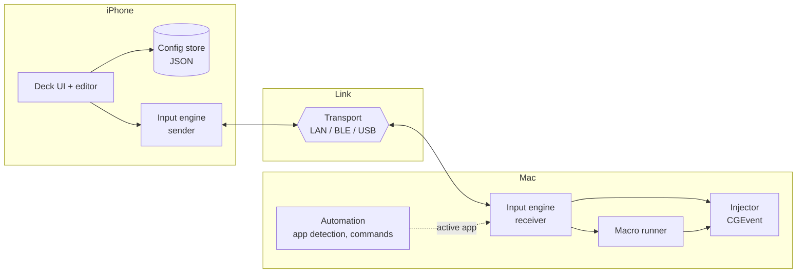

# Architecture

## Components



| System | Owns | Must not |
|---|---|---|
| iPhone app | Screens, button grid, editor, config storage, haptics | Know about transports or key injection |
| Input engine (shared package) | Protocol, session, transport abstraction, held-key tracking, release-all rules | Contain UI or `CGEvent` calls |
| Mac companion | Injection, macro execution, permissions, status UI, later automation | Trust the iPhone for modifier state (see PROTOCOL invariants) |

Rationale: [ADR-0002](adr/0002-three-system-separation.md).

## Operating modes

| Mode | Behavior | Source of layout |
|---|---|---|
| Command Deck | Grid of programmable buttons | Workspace config |
| Keyboard | Full key layout with sticky/hold modifiers | Built-in layout, optional per-key overrides |
| Mouse | Trackpad surface, buttons, scroll | Built-in |
| Macros | Library of multi-step actions, run from any button | `macros` in config |
| Workspaces | Named button layouts, switchable, optionally bound to an app | `workspaces` in config |

Mode is a property of a workspace (`kind`: `deck`, `keyboard`, `mouse`).

## Data flow for one button press

1. UI resolves the button's action from config.
2. A `key` tap becomes a single atomic `tap` message. A `macro` is sent whole as a `macro` message. A key
   configured as `hold` sends `down`, then heartbeats, then `up`.
3. The transport delivers to the Mac. The receiver updates its held-key state and hands events to the injector.
4. The injector posts `CGEvent`s with flags derived from the receiver's own held-modifier state.

## Planned repository layout

Created as each stage starts, not before.

```
apps/ios/           SwiftUI app (iPhone UI)
apps/mac/           Companion menu-bar app
packages/DeckCore/  Swift package: protocol, session, config models, key table
spec/               Schema and key table (language-neutral source of truth)
examples/           Sample configs, also used as test fixtures
tools/              Dev tooling (config validator)
tests/              Tooling tests
docs/               Architecture, protocol, decisions, test procedures
```

## Technology choices (initial)

- Swift and SwiftUI on both platforms; one shared Swift package.
- Network.framework for the LAN transport; CoreBluetooth for the BLE spike.
- Config as JSON files in the app container, exportable ([ADR-0003](adr/0003-configuration-as-data.md)).
- Companion runs as a menu-bar app, starts at login, shows connection state and permission status.

## Non-goals (for now)

- Android or Windows/Linux receivers.
- Operation at the login window or pre-boot (a hardware HID transport would be needed; see backlog).
- Cloud sync.
